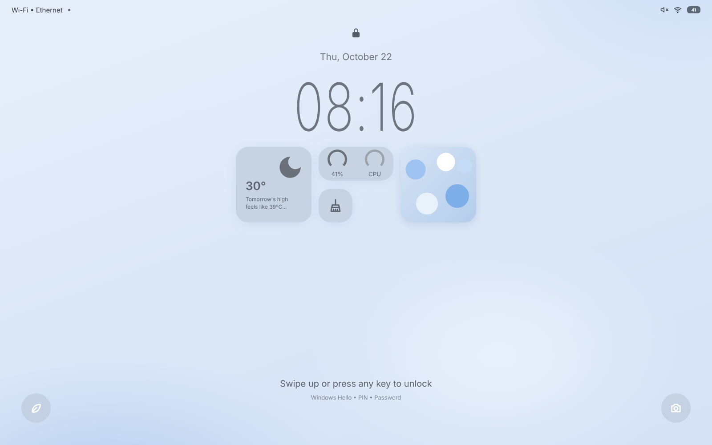
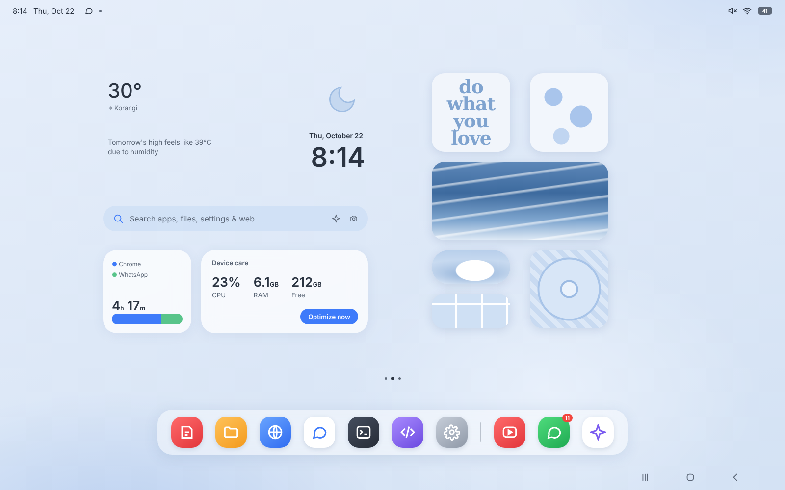
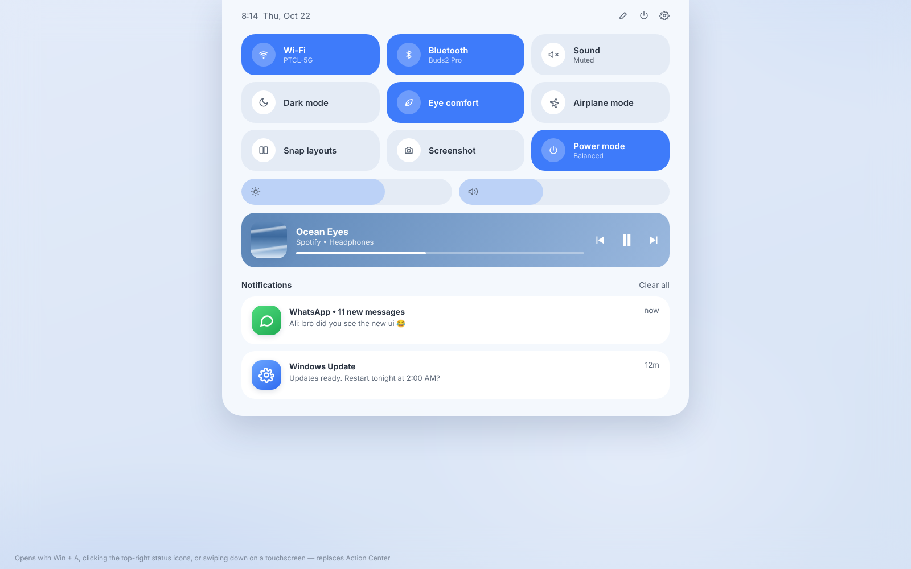
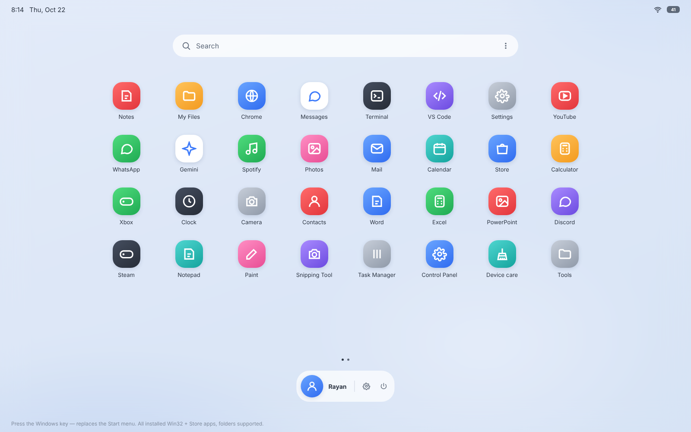
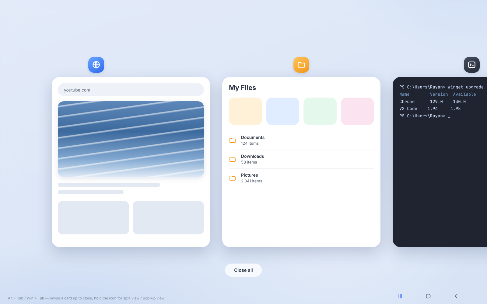
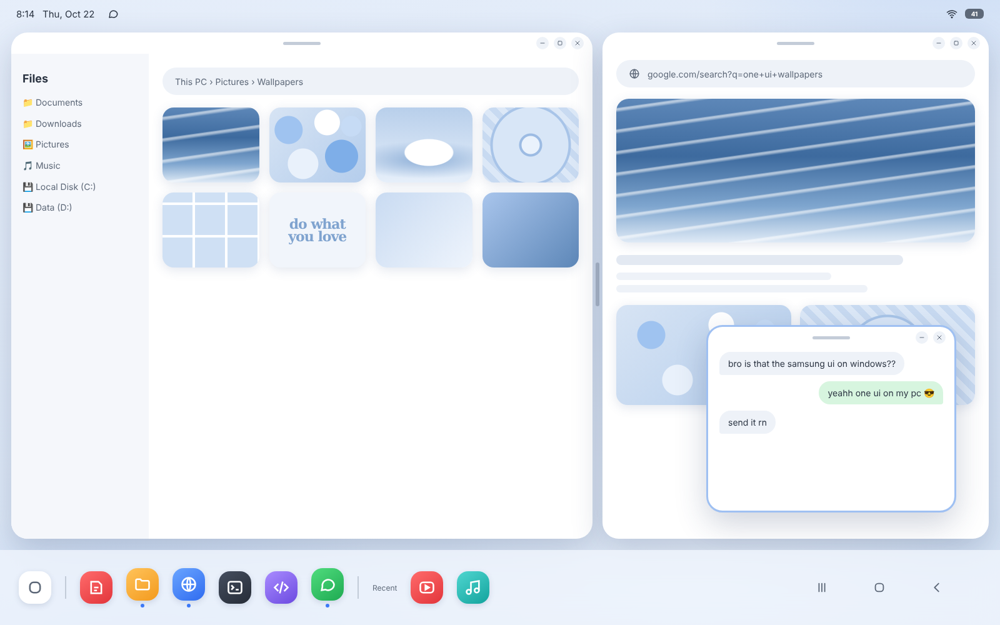
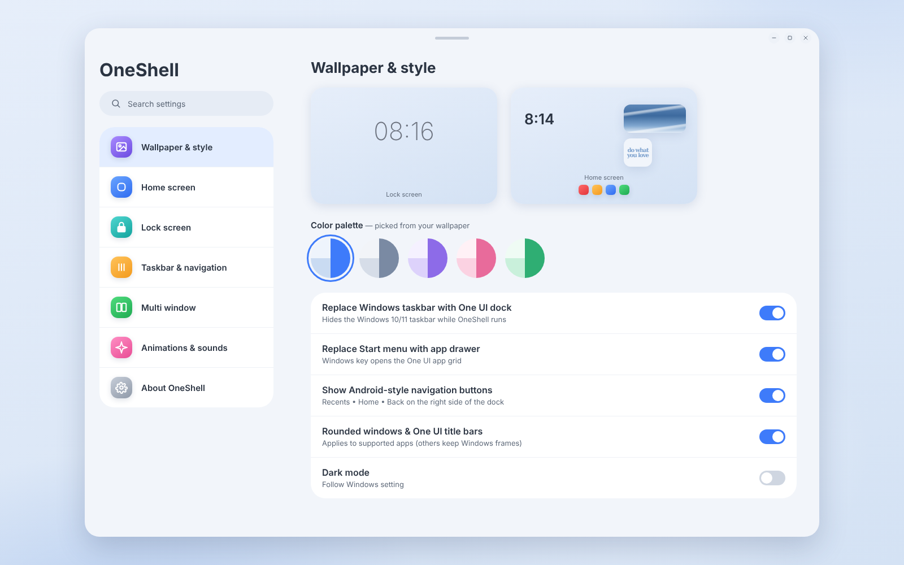

# OneShell: One UI (Galaxy Tab S9) for Windows 10 and 11

OneShell makes Windows look and work like Samsung One UI on a Galaxy Tab S9. It replaces the
taskbar, Start menu, Action Center and Alt+Tab with One UI versions that look exactly like the
mockups.

| Screen | Replaces | How to open |
|--------|----------|-------------|
|  Lock screen | — | At sign-in and after sleep |
|  Home screen + dock | Desktop + taskbar | Always there |
|  Quick panel | Action Center / Quick Settings | Win + A |
|  App drawer | Start menu | Windows key, or the search bar |
|  Recent apps | Alt+Tab / Task View | Win + Tab, or the Recents button |
|  Taskbar, split view, pop-up view | Snap | Tap an app icon in Recent apps |
|  OneShell settings | — | Tray icon, or right-click the home screen |

## Install

1. Open the repo's **Actions** tab and pick the latest **Build Windows installer** run.
2. Download the **OneShell-Setup** artifact, unzip it and run `OneShell Setup x.y.z.exe`.
   (It isn't code-signed, so SmartScreen may warn you: click *More info → Run anyway*.)
3. OneShell starts right away and then with Windows every time you sign in.

**To get the normal Windows back:** right-click the OneShell tray icon and choose *Quit OneShell*,
or press **Ctrl + Alt + Shift + Q** at any time. The Windows taskbar comes back even if OneShell
crashes.

## What works

- **Home screen:** live clock, weather from Open-Meteo (city detected from your IP, or set one in
  settings), search bar, screen time, Device care (CPU / RAM / free disk, plus *Optimize now*,
  which trims app memory), and six photo widgets (double-click one to choose your own picture).
- **Dock:** pinned apps plus recent apps on the home screen. It turns into the full-width One UI
  taskbar with running-app dots when an app is open. Right-click to pin or unpin.
  Recents / Home / Back buttons.
- **App drawer:** every Start menu app (desktop and Store apps) with real icons, search, pages and
  pin to dock.
- **Quick panel:** Wi-Fi (connect/disconnect), mute, dark mode (switches Windows too), snap layouts,
  screenshot, power mode, volume and brightness sliders, media controls, and lock / sleep / restart /
  shut down.
- **Recent apps:** live window thumbnails. Swipe a card up to close it, then *Close all*. Tap an
  icon for split screen or pop-up view.
- **Lock screen:** swipe up, scroll, or press any key to unlock.
- **Settings:** wallpaper, accent color palette, photo widgets, dock apps, weather city and units,
  lock screen options, key shortcuts, rounded corners, animations and start with Windows.

## Windows 10 vs 11

Everything works on both. The only difference: *rounded window corners* for other apps needs
Windows 11, because Windows 10 has no API for it.

## Limits (things Windows doesn't let an app do)

- **Notifications:** Windows doesn't let normal apps read other apps' notifications, so the quick
  panel can't list them. Windows still shows its own notification pop-ups.
- **Bluetooth, Eye comfort (Night light) and Airplane mode** tiles open the matching Windows
  Settings page instead of toggling directly.
- **The real sign-in screen** stays Windows' own (Windows Hello / PIN / password). The One UI lock
  screen is shown after you sign in and when the PC wakes up.
- **Brightness** only works on built-in laptop screens; external monitors don't expose it.
- **One UI title bars** (the little pill at the top) are only on OneShell's own windows. Other apps
  keep their normal title bars.

## Build it yourself (on Windows)

```powershell
npm install
npm run build:native   # compiles the C# helper with the csc.exe built into Windows
npm start              # run from source
npm run dist           # make the installer in dist\
```

## How it's built

- `src/main/`: Electron main process. It owns the desktop, dock, overlay (lock / quick panel /
  drawer / recents) and settings windows, polls system info and lists installed apps.
- `src/renderer/`: the UI. It uses the same HTML/CSS as `mockups/mockup.html`, laid out on a
  1600×1000 canvas and zoomed to fit your screen. `dev-mock.js` lets you open `ui.html` in a
  normal browser (`ui.html?view=overlay&mode=drawer`) to work on the design.
- `src/native/OneShellNative.cs`: a small Win32 helper. It hides the taskbar, reserves screen
  space for the dock, catches the Win / Win+A / Win+Tab keys, and lists, switches, snaps and
  closes windows. It also handles app icons, volume, brightness, battery, media keys and dark mode.
  It talks JSON over stdin/stdout.
